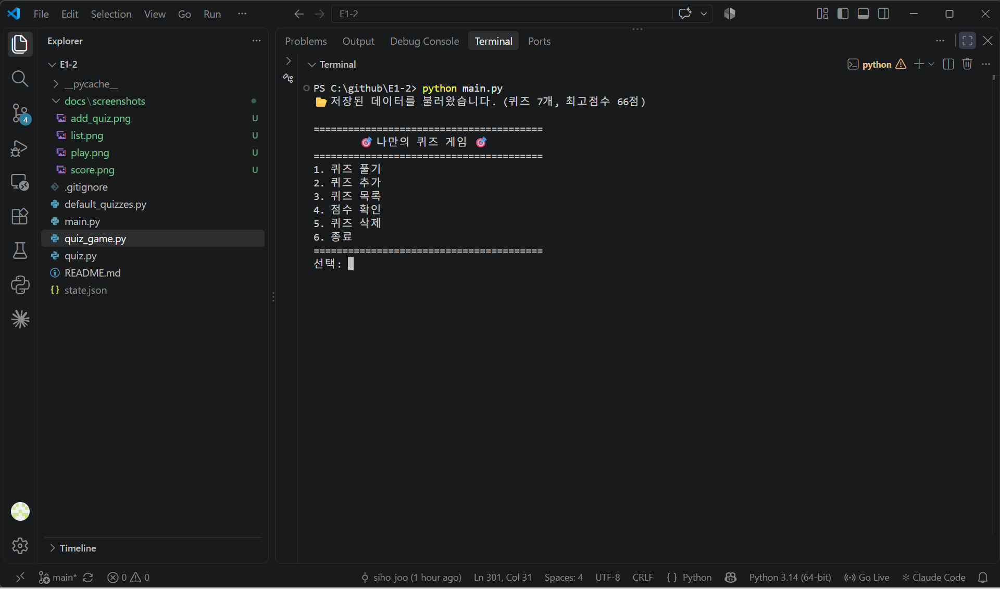
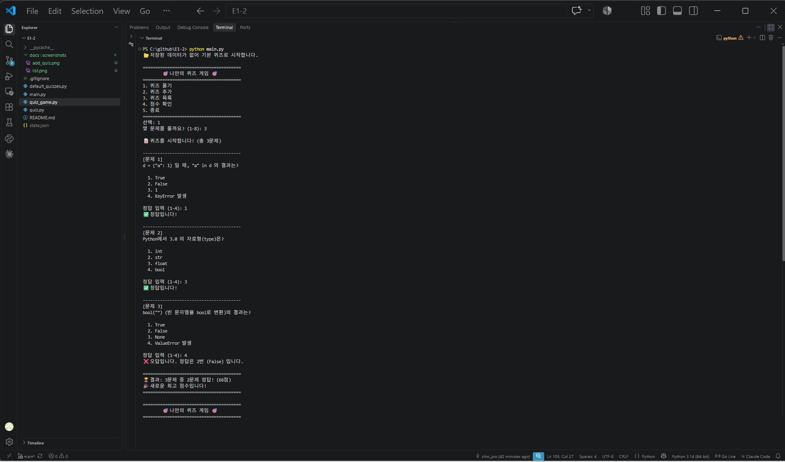
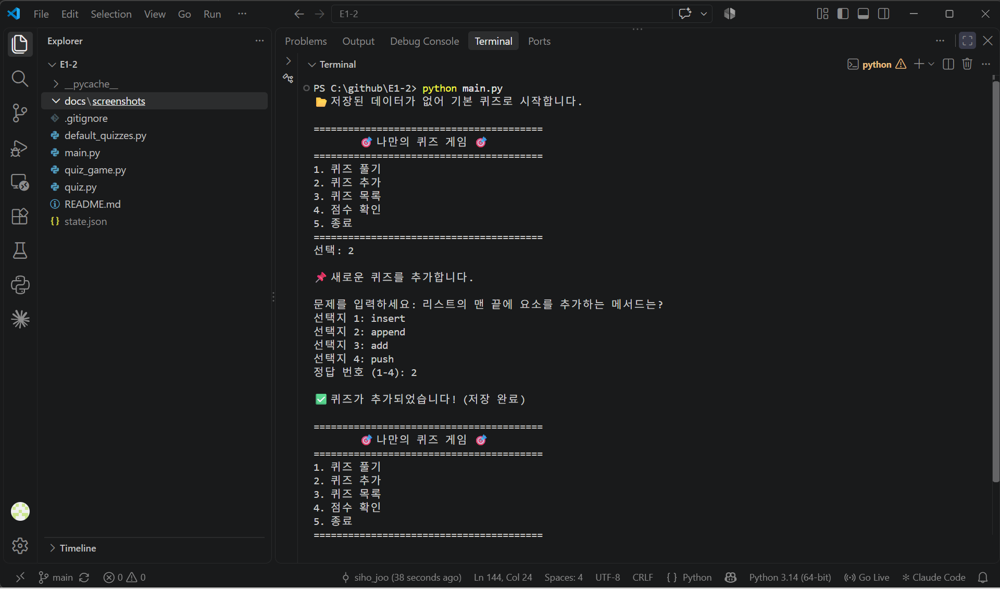
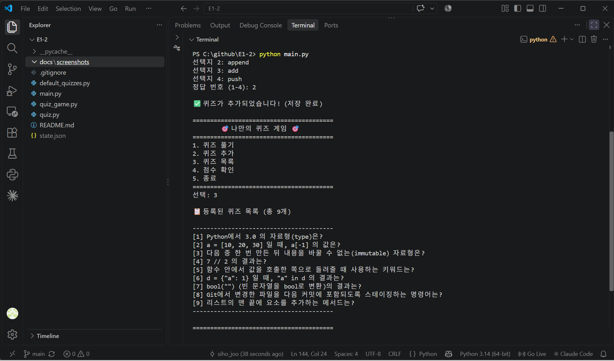
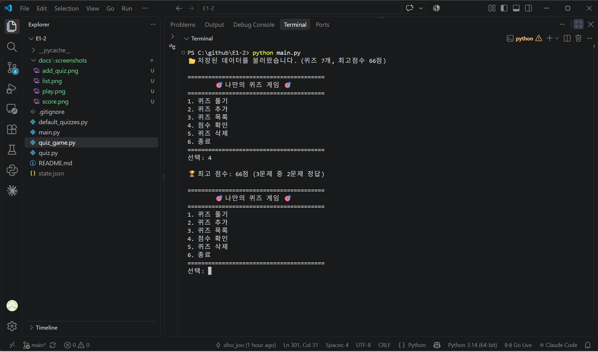
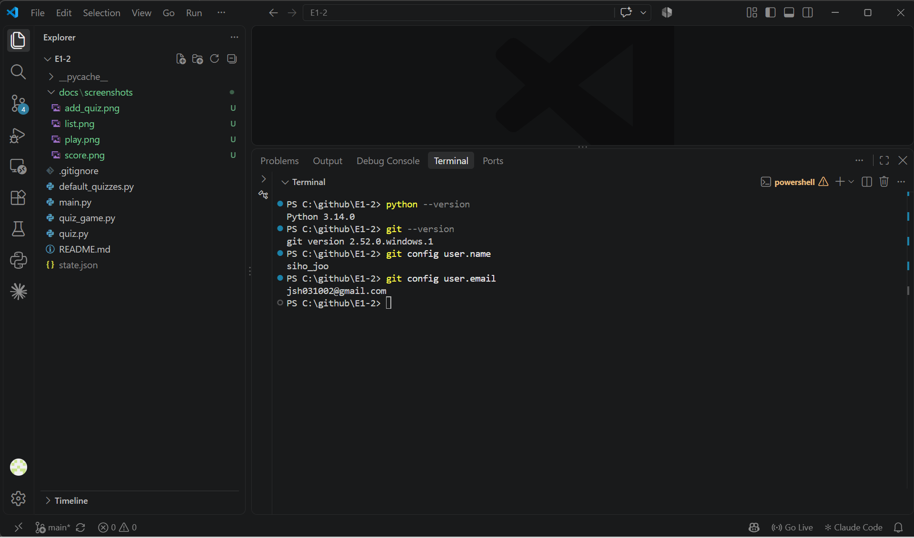
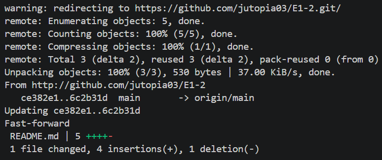
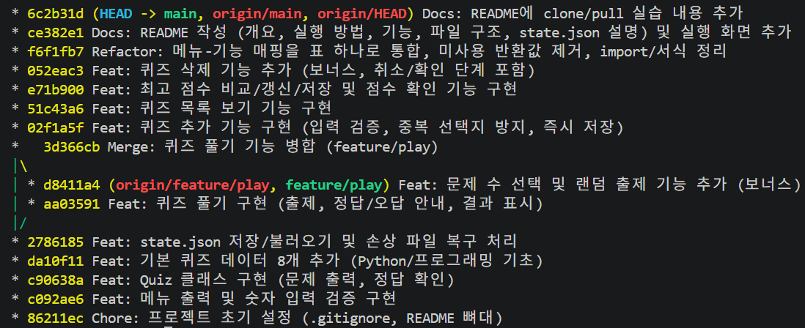

# 🎯 나만의 퀴즈 게임 (E1-2)

## 프로젝트 개요
터미널에서 동작하는 4지선다 퀴즈 게임입니다.
메뉴에서 번호를 선택해 퀴즈를 풀고, 새 퀴즈를 등록하고, 최고 점수를 확인할 수 있습니다.
퀴즈와 최고 점수는 `state.json` 파일에 저장되어 프로그램을 종료했다가 다시 실행해도 유지됩니다.

- 언어: Python 3.10 이상 (표준 라이브러리만 사용)
- 구조: `Quiz`(퀴즈 한 문제)와 `QuizGame`(게임 전체 진행) 두 클래스로 역할 분리
- 버전 관리: Git 기능 단위 커밋, 브랜치(`feature/play`) 작업 후 `main` 병합

## 퀴즈 주제 및 선정 이유
**주제: Python / 프로그래밍 기초**

이번 미션의 목표가 Python 기초 문법과 Git을 직접 사용하며 익히는 것이어서, 퀴즈 주제도 같은 내용으로 정했습니다.
퀴즈를 만들려면 정답뿐 아니라 헷갈리기 쉬운 오답까지 정확히 알아야 하므로, 문제를 만드는 과정 자체가 자료형·연산자·Git 명령어를 다시 점검하는 복습이 됩니다.

## 실행 방법
```bash
git clone https://github.com/jutopia03/E1-2.git
cd E1-2
python main.py        # macOS/Linux에서는 python3 main.py
```
- 첫 실행 시 `state.json`이 없으므로 기본 퀴즈 8개로 시작하며, 종료 시 자동으로 생성됩니다.

## 기능 목록
| 메뉴 | 기능 | 설명 |
|---|---|---|
| 1 | 퀴즈 풀기 | 풀 문제 수를 고르면 무작위 순서로 출제, 정답/오답 안내 후 결과(100점 환산) 표시 |
| 2 | 퀴즈 추가 | 문제, 선택지 4개, 정답 번호를 입력받아 등록 후 즉시 저장 (빈 입력·중복 선택지 방지) |
| 3 | 퀴즈 목록 | 등록된 퀴즈의 문제를 번호와 함께 표시 (정답은 표시하지 않음) |
| 4 | 점수 확인 | 최고 점수와 그때의 정답 수 표시 |
| 5 | 퀴즈 삭제 | 목록에서 번호를 골라 삭제 (취소·확인 단계 포함) |
| 6 | 종료 | 데이터를 저장하고 종료 |

**보너스 구현:** 랜덤 출제, 문제 수 선택, 퀴즈 삭제

**입력/예외 처리**
- 모든 입력의 앞뒤 공백 제거
- 숫자가 아닌 입력(`abc`), 범위 밖 숫자(`9`, `0`), 빈 입력은 안내 메시지 출력 후 다시 입력
- `Ctrl+C`(KeyboardInterrupt), 입력 스트림 종료(EOFError) 시 데이터를 저장하고 안전하게 종료
- `state.json`이 없거나 손상된 경우 기본 퀴즈 데이터로 시작/복구

## 파일 구조
```
E1-2/
├── main.py              # 프로그램 시작 지점 (QuizGame 실행)
├── quiz_game.py         # QuizGame 클래스: 메뉴, 입력 검증, 각 기능, 파일 저장/불러오기
├── quiz.py              # Quiz 클래스: 문제/선택지/정답, 출력, 정답 확인, dict 변환·검증
├── default_quizzes.py   # 기본 퀴즈 8개 (파일이 없거나 손상됐을 때 사용)
├── docs/screenshots/    # 실행 화면 캡처
├── .gitignore
├── README.md
└── state.json           # 실행 시 자동 생성 (Git 추적 제외)
```

## 데이터 파일 설명 (state.json)
- **경로:** 프로젝트 루트 `E1-2/state.json` (실행 위치와 상관없이 `quiz_game.py`가 있는 폴더 기준)
- **역할:** 퀴즈 목록과 최고 점수를 저장해 프로그램을 다시 실행해도 데이터가 유지되게 함
- **인코딩:** UTF-8 (한글을 그대로 저장)
- **저장 시점:** 퀴즈 추가·삭제 직후, 최고 점수 갱신 직후, 프로그램 종료 시
- **Git 추적 제외:** 실행할 때마다 바뀌는 데이터라 `.gitignore`에 포함. clone 직후에는 파일이 없으므로 기본 퀴즈로 시작합니다.

**스키마**
| 키 | 타입 | 설명 |
|---|---|---|
| `quizzes` | list | 퀴즈 목록 |
| `quizzes[].question` | str | 문제 |
| `quizzes[].choices` | list[str] | 선택지 4개 |
| `quizzes[].answer` | int | 정답 번호 (1~4) |
| `best_score` | int \| null | 최고 점수 (100점 만점 환산, 소수점 버림). 기록이 없으면 `null` |
| `best_correct` | int \| null | 최고 점수 당시 맞힌 문제 수 |
| `best_total` | int \| null | 최고 점수 당시 푼 문제 수 |

**예시**
```json
{
    "quizzes": [
        {
            "question": "7 // 2 의 결과는?",
            "choices": ["3", "3.5", "4", "1"],
            "answer": 1
        }
    ],
    "best_score": 66,
    "best_correct": 2,
    "best_total": 3
}
```

**손상 처리:** JSON 문법 오류, 필수 키 누락, 잘못된 값(예: `answer`가 5)이 있으면 안내 메시지를 출력하고 기본 퀴즈 데이터로 복구합니다.

## 실행 화면
| 메뉴 (재실행 시 데이터 유지) | 퀴즈 풀기 |
|---|---|
|  |  |

| 퀴즈 추가 | 퀴즈 목록 | 점수 확인 |
|---|---|---|
|  |  |  |

## Git 저장소 복제 실습
- 별도 디렉터리(`E1-2-clone`)에 저장소를 `clone`하여 이 내용을 추가한 뒤 `commit` → `push`하고, 기존 작업 디렉터리(`E1-2`)에서 `pull`로 변경사항을 반영했습니다.

## 제출용 스크린샷
| 개발 환경 (VSCode, Python, Git 설정) | clone / pull 실습 |
|---|---|
|  |  |

**Git 커밋 이력 (`git log --oneline --graph`)**



> 위 이력은 clone/pull 실습까지 완료한 시점의 캡처이며, 이후 이 스크린샷들을 추가하는 커밋 1개가 더 있습니다.